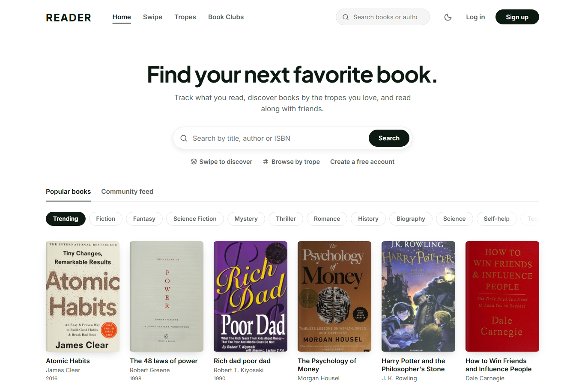

# Reader

Reader is a book tracking and discovery web app. You can keep shelves, write reviews, track reading streaks and a yearly goal, read along with others in book clubs, and find new books by swiping or by micro-tropes such as "found family" or "slow burn". Each book page also has AI features powered by Google Gemini.

**Live demo:** http://56.228.91.213:8081




## Features

**Tracking**
- Want to Read, Currently Reading and Read shelves, plus custom shelves
- Ratings and reviews (one per user per book), with likes and threaded replies
- Reading heatmap and streaks
- Yearly reading challenge with a shareable year-in-review card

**Discovery**
- Search across Open Library (and Google Books when a key is set), re-ranked so the actual book comes before summaries and knock-offs
- Swipe deck: right adds to Want to Read, left skips, `Z` undoes; filter by genre or trope
- Community trope tags with voting, autocomplete and multi-trope filtering

**Social**
- Book clubs with per-chapter progress for every member and a chat where spoilers are hidden until clicked
- Community activity feed

**AI (Gemini)**
- Chat about any book, with spoiler avoidance
- "Should I read this?" score based on the books you rated 5 stars
- One-paragraph summary of a book's reviews

## Tech Stack

| Layer     | Technology                                                    |
|-----------|---------------------------------------------------------------|
| Frontend  | React 19, React Router 7, Vite 8, Axios                       |
| Backend   | Node.js, Express 5                                            |
| Database  | MongoDB with Mongoose                                         |
| Auth      | JWT (Bearer tokens), bcrypt                                   |
| AI        | Google Gemini (`@google/generative-ai`)                       |
| Security  | Helmet, express-rate-limit, input validation on every route   |
| Book data | Open Library API, optional Google Books API                   |
| Hosting   | AWS EC2, Nginx, PM2                                           |

## How It Works

### Book data

Book lists and search results come from Open Library. Results are re-ranked by provider relevance, edition count and how well the title and author match, with penalties for summaries and study guides. Books are saved to MongoDB the first time they are seen, and full descriptions are fetched once per book, on demand.

Responses are cached in two layers: an in-memory cache and a MongoDB collection. Browse lists are kept for 6 hours and searches for 24 hours. When an entry goes stale, the old value is returned immediately and refreshed in the background. A background job keeps the most popular lists warm.

Open Library cover images are slow to load directly, so the API proxies them through `/api/covers/:id-:size.jpg`, caches each one on disk and serves it with immutable cache headers.

### AI cost control

All Gemini calls go through one service (`backend/services/ai.js`), which:

- uses a configurable model (`GEMINI_MODEL`)
- caps output tokens per feature and trims chat history and book context before sending
- caches recommendations per user and book for 7 days, recomputing only when the user's 5-star books change
- caches review summaries until the reviews change
- limits each user to `AI_HOURLY_LIMIT` AI requests per hour

### Security and reliability

- Helmet sets security headers, including a Content Security Policy
- Rate limits: 300 API requests per minute per IP, 20 failed logins per 15 minutes, 40 external searches per minute, and a per-user hourly AI limit
- Every endpoint validates its input; errors are mapped to proper status codes in one error handler, and internal details are never sent to the client in production
- Avatar uploads are limited to 2 MB of image types and served with a sandboxing CSP, so an uploaded SVG cannot run scripts
- The server checks required configuration at startup, runs one-time data migrations, exposes `GET /api/health`, and shuts down cleanly on `SIGTERM`

### Frontend

Every page is lazy-loaded, and React and other libraries are split into separate vendor chunks so they stay cached between deploys. An Axios client attaches the token to each request and signs the user out if the API returns 401. The app includes dark mode, loading skeletons, empty and error states, an error boundary and a 404 page.

## API Overview

| Area           | Base path                   | Examples                                                      |
|----------------|-----------------------------|---------------------------------------------------------------|
| Auth           | `/api/auth`                 | register, login, profile, avatar upload, custom shelves       |
| Books          | `/api/books`                | browse, search, details, shelf status, swipe, AI chat         |
| Reviews        | `/api/books/:id/reviews`    | post, like, reply, AI summary                                 |
| Tags           | `/api/books/:id/tags`, `/api/tags` | tag a book, search tropes, books matching several tropes |
| Book clubs     | `/api/clubs`                | create, join, chapter progress, chat                          |
| Reading        | `/api/reading`              | log today, heatmap data, yearly challenge                     |
| Activity       | `/api/activities`           | community feed                                                |
| Covers         | `/api/covers`               | cached cover images                                           |

Browsing books and reading book pages is public. Search, shelves, clubs, the activity feed and AI features require signing in.

## Running Locally

You need Node.js 20+ and MongoDB 6+.

```bash
git clone https://github.com/HumayunSaghir/Reader.git
cd Reader/reader

# API (http://localhost:5000)
cd backend
cp .env.example .env      # set MONGO_URI and JWT_SECRET
npm install
npm run dev

# Web app (http://localhost:5173), in a second terminal
cd frontend
cp .env.example .env      # VITE_API_URL=http://localhost:5000
npm install
npm run dev
```

### Environment Variables

The full list with comments is in [`reader/backend/.env.example`](reader/backend/.env.example). The main ones:

| Variable          | Required | Description                                                            |
|-------------------|----------|------------------------------------------------------------------------|
| `MONGO_URI`       | Yes      | MongoDB connection string                                              |
| `JWT_SECRET`      | Yes      | Token signing key; at least 32 characters in production                |
| `PORT`            | No       | API port (default `5000`)                                              |
| `NODE_ENV`        | No       | `production` enables stricter checks and generic error messages        |
| `FRONTEND_DIST`   | No       | Path to the built frontend, so the API serves the web app itself       |
| `TRUST_PROXY`     | No       | Number of proxies in front of the app (set to `1` behind Nginx)        |
| `ALLOW_HTTP`      | No       | `true` when served without TLS; turns off HSTS and HTTPS upgrades      |
| `GEMINI_API_KEY`  | No       | Enables the AI features                                                |
| `AI_HOURLY_LIMIT` | No       | AI requests per user per hour (default `30`)                           |
| `GOOGLE_BOOKS_API_KEY` | No  | Adds Google Books results and descriptions                             |

## Deployment

The live demo runs on an AWS EC2 instance (t4g.micro, Ubuntu 24.04) shared with two other small apps. The frontend is built once and served by the Express API, so a single Node process handles both. PM2 keeps it running, and Nginx listens on port 8081 and proxies to it. MongoDB runs on the same machine and only listens on localhost.

```
Browser → Nginx :8081 → Node.js / Express (PM2) :5000 → MongoDB :27017 (localhost)
                         ├── /api/*     REST API
                         └── /*         built React app
```

The steps assume Node.js 20, PM2, Nginx and MongoDB are installed, and that the security group allows inbound TCP on 8081.

**1. Get the code and configure the API**

```bash
git clone https://github.com/HumayunSaghir/Reader.git
cd Reader/reader/backend
npm ci --omit=dev
```

Create `reader/backend/.env`:

```
NODE_ENV=production
PORT=5000
MONGO_URI=mongodb://127.0.0.1:27017/reader
JWT_SECRET=<output of: openssl rand -hex 32>
TRUST_PROXY=1
FRONTEND_DIST=../frontend/dist
ALLOW_HTTP=true          # only while the site has no HTTPS
GEMINI_API_KEY=<your key>
AI_HOURLY_LIMIT=10
```

**2. Build the frontend**

```bash
cd ../frontend
npm ci
VITE_API_URL= npm run build
```

`VITE_API_URL` must be empty here so the app calls the API on the same origin. If a local `.env` sets it to `http://localhost:5000`, that address gets built into the bundle and the deployed site cannot load data.

**3. Start the API with PM2**

```bash
cd ../backend
pm2 start server.js --name reader
pm2 save
```

**4. Configure Nginx** in `/etc/nginx/sites-available/reader`:

```nginx
server {
    listen 8081;
    listen [::]:8081;
    server_name _;

    client_max_body_size 3M;

    location / {
        proxy_pass http://127.0.0.1:5000;
        proxy_http_version 1.1;
        proxy_set_header Host $host;
        proxy_set_header X-Real-IP $remote_addr;
        proxy_set_header X-Forwarded-For $proxy_add_x_forwarded_for;
        proxy_set_header X-Forwarded-Proto $scheme;
    }
}
```

```bash
sudo ln -s /etc/nginx/sites-available/reader /etc/nginx/sites-enabled/
sudo nginx -t && sudo systemctl reload nginx
```

**Updating**

```bash
cd ~/Reader && git pull
cd reader/backend && npm ci --omit=dev
cd ../frontend && npm ci && VITE_API_URL= npm run build
pm2 restart reader
```

With a domain and HTTPS, remove `ALLOW_HTTP` so the stricter security headers apply.

## Project Structure

```
reader/
├── backend/
│   ├── server.js          Express app: security headers, routes, static frontend, shutdown
│   ├── config/            Environment checks, MongoDB connection, data migrations
│   ├── controllers/       Auth, books, reviews, tags, clubs, reading log, challenge, discover
│   ├── middlewares/       Auth, rate limits, upload validation, error handling
│   ├── models/            Mongoose schemas
│   ├── routes/            Express routers
│   └── services/          Book providers, catalog ranking, caching, cover cache, Gemini
├── frontend/
│   └── src/
│       ├── api/           Axios client
│       ├── components/    Book cards, heatmap, challenge, tags, reviews, navbar
│       ├── contexts/      Auth state
│       └── pages/         Home, Search, Book, Discover, Tropes, Clubs, Profile, Auth
└── mobile/                Flutter client (work in progress, not covered here)
```

## Limitations and Next Steps

- Progress updates by page number or percentage are not built yet
- Rate limits are stored in memory, so running several instances would need a shared store such as Redis
- The Gemini SDK in use (`@google/generative-ai`) is deprecated and should be replaced with `@google/genai`
- There is no automated test suite or CI yet
- The demo is served over plain HTTP because it has no domain name attached

## Author

**Humayun Saghir**, [github.com/HumayunSaghir](https://github.com/HumayunSaghir)
